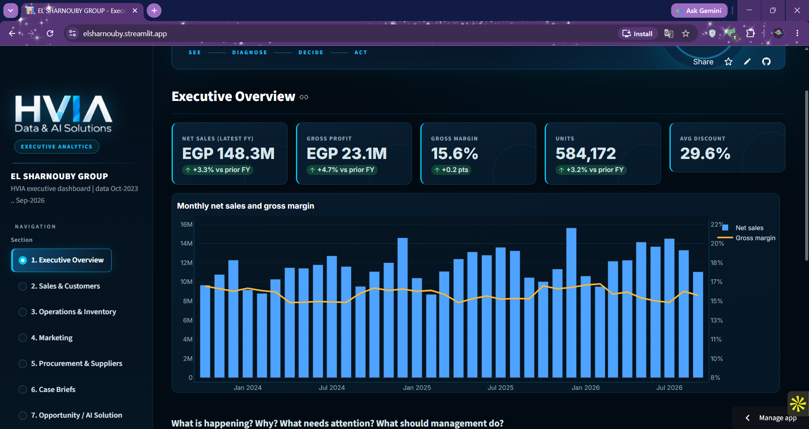

<div align="center">

[](https://elsharnouby.streamlit.app/)

[](https://python.org)
[](https://elsharnouby.streamlit.app/)
[](https://pandas.pydata.org)
[](https://scikit-learn.org)
[](https://plotly.com)
[](#)

> **Raw data in. A clear answer to one question out: where is EL SHARNOUBY losing profit, and what should management do first?**
>
> **10 case briefs · a new opportunity nobody asked for · a working Deal Desk prototype · a 7-section executive dashboard.**

**[🚀 Open the Live Dashboard →](https://elsharnouby.streamlit.app/)**

| 🧹 Pipeline | 📊 Analysis | 🔮 Models | 🖥️ Dashboard | 📝 Delivery |
|:---:|:---:|:---:|:---:|:---:|
| **81 data checks → 19 datasets** | **10 case briefs + KPI framework** | **Forecast · Replenishment · Deal Desk** | **7 sections, live data** | **Report + executive deck** |

</div>

---

## ✦ App Preview

<p align="center">
  
</p>

---

## ✦ The Answer in 30 Seconds

EL SHARNOUBY sold **EGP 421.3M** over three years and kept **EGP 64.9M** as gross profit (**15.4%**). Growth slowed from **+10.8%** to **+3.3%**, and margin did not improve. The reason is wholesale pricing.

| | Wholesale | Retail store | Online store |
|:--|:--:|:--:|:--:|
| Share of sales | **85%** | 7% | 8% |
| Share of gross profit | 66% | 17% | 18% |
| Gross margin | **11.9%** | 37.0% | 34.9% |

Wholesale discounts (28–38%) follow **no order-size logic**, buy **no measurable extra volume**, and produced **4,876 below-cost invoices**.
The proposed fix, a **Wholesale Deal Desk**, was simulated on three years of real invoices: **+EGP 2.9–4.9M gross profit per year** (Phase 1), still profitable if re-priced customers cut volume by up to 48%.

> *Scope: Oct 2023 – Sep 2026, three fiscal years (Oct–Sep). Gross profit uses estimated COGS. Opportunity values are estimates, not realised profit.*

---

## ✦ What is This?

An end-to-end business discovery project for **EL SHARNOUBY GROUP**: LEO MODA (retail + online), the Wholesale Desk, and the LEO Production Hub / LEO PRINT factory.

It follows a business-first flow, not a chart-first one:

```
Business → Data → Quality → Integration → KPIs → Analysis → Case Briefs
        → Root Causes → New Opportunity → Solution Prototype → Dashboard → Recommendations
```

Everything is reproducible with one command, and every number in the report, deck and dashboard comes from the same code.

---

## ✦ Dashboard Sections

| # | Section | Answers |
|:-:|:--------|:--------|
| 1 | **Executive Overview** | What is happening? Why? What needs attention? What should we do? |
| 2 | **Sales & Customers** | Channel economics, discount impact, RFM segments, cohort retention |
| 3 | **Operations & Inventory** | Stock cover, forecast, replenishment plan, production, quality, printers |
| 4 | **Marketing** | Platform ranking, attribution warning, reallocation simulator |
| 5 | **Procurement & Suppliers** | On-time delivery trend, action matrix, material shortage risk |
| 6 | **Case Briefs** | All 10 HVIA cases with findings and the value-at-stake table |
| 7 | **Opportunity / AI Solution** | Policy simulator and an interactive Deal Desk quote checker |

Sidebar filters (channel, fiscal year) apply to the sales pages.

---

## ✦ Key Findings

| Area | Finding | Evidence |
|:-----|:--------|:---------|
| 💰 **Profitability** | Growth is not turning into profit | Sales FY24 / FY25 / FY26: 129.5M / 143.5M / 148.3M; margin 15.3% → 15.6% |
| 🏷️ **Discounts** | Deeper discounts buy no visible extra volume | Jun–Jul 2026 promo: discount 7.3% → 9.7%, volume lift +5.2% vs +5.7% / +5.9% in earlier years (association, not proven cause) |
| 🧑‍🤝‍🧑 **Customers** | A valuable group has gone quiet | 3,745 high-frequency customers = 16% of base, 32% of retail-customer sales, 65% opted-in for WhatsApp/SMS |
| 📦 **Inventory** | Stock sits in the wrong channel | Wholesale ~11 days of cover (36/59 SKUs below reorder point) vs ~115 days retail/online; EGP 7.5M excess |
| 🚚 **Suppliers** | Two suppliers collapsed in 2025 | SUP04 / SUP09 on-time ~65% → ~15%; the other ten stay near 71% |
| 🏭 **Factory** | Delays are internal | Sewing + Finishing = 68% of delay days; LINE-04 late 20% vs 15% |
| ✅ **Quality** | Cost of poor quality is large and spread evenly | EGP 20.3M estimated = 31% of gross profit; 12% unclassified |
| 📣 **Marketing** | Rank platforms, don't trust absolute ROAS | Attributed revenue is 5.5× actual online sales |

---

## ✦ The Opportunity Nobody Asked For: Wholesale Discount Governance

| Step | What the data showed |
|:-----|:---------------------|
| **Problem** | 85% of sales earn only 11.9% margin; unit cost is the same in every channel, so the gap is price |
| **Evidence** | Each discount level (28/30/32/35/38%) appears in ~20% of orders at *every* order size; a 10-feature model cannot predict the discount (held-out R² = 0.008); a deeper discount does not change order size (p = 0.58) |
| **Root cause** | No discount policy or approval control |
| **Impact** | EGP 173.9M of discount given = 80% of pre-discount margin; 4,876 below-cost invoices (EGP −1.4M) |
| **Solution** | **Wholesale Deal Desk** (below) |

### Deal Desk workflow

```
Quote request → Order size & customer → Maximum discount → Margin check → Approval if exception → Profitable quote
```

| Phase | Rule |
|:------|:-----|
| **1 · Volume-tiered cap** | 12–23 units max 28% · 24–47 units max 30% · 48+ units max 32% |
| **2 · Margin floor** | Minimum 15% margin; manager approval at ≥ 8%, director below, never below cost |

**Status:** a working prototype exists (`modeling.evaluate_quote()` and the quote checker in the dashboard). It is **not yet connected** to a real quoting or approval process.

---

## ✦ Value at Stake (estimated annual gross profit)

| Lever | Low | **Base** | High |
|:------|:--:|:--:|:--:|
| Wholesale discount cap (Phase 1) | 2.85M | **3.87M** | 4.88M |
| Margin-floor exceptions (Phase 2) | 2.67M | **3.29M** | 3.91M |
| Cost of poor quality −10 / 20 / 30% | 0.54M | **1.09M** | 1.63M |
| Win-back of at-risk customers | 0.12M | **0.24M** | 0.36M |
| Wholesale stockout recovery | 0.09M | **0.18M** | 0.27M |
| Marketing reallocation | −0.02M | **0.09M** | 0.99M |
| Online size/fit returns | 0.01M | **0.02M** | 0.04M |
| **Total** | | **≈ EGP 8.8M / year** | |

*Estimates before implementation cost. Wholesale pricing is ≈ 82% of the base case.*

---

## ✦ Project Structure

```
EL_SHARNOUBY_HVIA/
├── README.md
├── requirements.txt
├── run_pipeline.py            ← one command: pipeline → analysis → models → figures → tables
│
├── data/
│   ├── raw/                   ← original files, never modified
│   └── processed/             ← 19 cleaned / integrated parquet datasets (generated)
│
├── src/
│   ├── utils.py               ← paths, formatting, plot style
│   ├── data_pipeline.py       ← validation, cleaning, integration, analytical datasets
│   ├── analysis.py            ← KPI framework + analysis for the 10 case briefs
│   ├── modeling.py            ← forecast, replenishment, Deal Desk engine, scenarios
│   └── visuals.py             ← static figures
│
├── notebooks/                 ← 01 data prep · 02 business analysis · 03 case briefs · 04 opportunity
├── dashboard/app.py           ← Streamlit executive dashboard (7 sections)
├── outputs/                   ← figures · tables · models
├── reports/final_report.md    ← full written report
├── powerpoint/                ← executive presentation for management
└── photo_app/                 ← dashboard screenshots used in this README
```

---

## ✦ How the Pipeline Works

| Step | What happens |
|:-----|:-------------|
| **1. Validate** | 81 checks (duplicates, keys, dates, arithmetic, reconciliation). 10 business-meaningful flags are kept and analysed, not deleted |
| **2. Clean & integrate** | Every join is checked for row-count preservation and many-to-one grain |
| **3. Analyse** | KPI framework, 10 case briefs, root-cause tests on month-over-month changes (to avoid fake trend correlations) |
| **4. Model** | Seasonal demand forecast, replenishment rules, discount diagnostic, policy simulator |
| **5. Deliver** | 32 figures, tables, `headline_metrics.json`, dashboard, report |

---

## ✦ Models, Kept Honest

| Model | Purpose | Validation |
|:------|:--------|:-----------|
| Seasonal-index demand forecast | 30/60/90-day demand per SKU × location | Three rolling backtests: **WAPE 23.3%** vs 28.6% seasonal-naive and 53.6% naive |
| Replenishment rules | Reorder point and order-up-to quantities | Forecast-error-based safety stock |
| Discount diagnostic (gradient boosting) | Tests whether anything known at quote time explains the discount | Time-based split, mean baseline, permutation importance: **R² = 0.008** |
| Policy simulator | Re-prices past wholesale invoices under each cap | 0–20% volume-loss sensitivity; break-even loss 48% (Phase 1) |

Rules and statistics come first; ML is used only where it adds evidence.

---

## ✦ Quick Start

```bash
# 1. Clone
git clone https://github.com/morad-elnahla/EL_SHARNOUBY_HVIA.git
cd EL_SHARNOUBY_HVIA

# 2. Virtual environment
python -m venv .venv
source .venv/bin/activate          # Windows: .venv\Scripts\activate

# 3. Install
pip install -r requirements.txt

# 4. Build everything (about 1 minute)
python run_pipeline.py             # add --skip-figures to skip the PNGs

# 5. Launch the dashboard
streamlit run dashboard/app.py     # http://localhost:8501
```

Re-run the notebooks (already executed):

```bash
jupyter nbconvert --to notebook --execute --inplace notebooks/0*.ipynb
```

Tested on Python 3.12 with pandas 3.0.

---

## ✦ Deploy to Streamlit Cloud

```
1. Push the repo to GitHub
2. Go to share.streamlit.io
3. Connect the repo → main file: dashboard/app.py → Deploy
```

`data/processed/` is regenerated automatically on first load if it is missing.

---

## ✦ Limitations: What to Validate Before Acting

- **COGS is estimated**, not a verified standard cost. Every profit figure depends on it.
- The zero price-response is observed **only inside the 28–38% discount range**; a pilot with a comparison group should come before a full rollout.
- **Three data sets do not fully reconcile:** marketing-attributed revenue (5.5× online sales), production orders (3.8× units sold), and purchases vs BOM quantities. Related conclusions rely on rates and rankings, not absolute values.
- Cohort-retention decline (91% → ~44%) should be verified against the CRM.
- The dataset is *modelled*, with unusually uniform quality and discount distributions.
- Value-at-stake figures are estimates, **not guaranteed realised profit**.

---

## ✦ Roadmap

- [x] Data pipeline with 81 validation checks
- [x] 10 case briefs, KPI framework, root-cause analysis
- [x] Demand forecast and replenishment rules
- [x] Deal Desk prototype and quote checker
- [x] Executive dashboard, report and presentation
- [ ] Pilot the Deal Desk with the 25 highest-leakage customers (90 days, with a comparison group)
- [ ] Connect the Deal Desk to a real quoting and approval workflow
- [ ] Win-back journeys for the 3,745 at-risk customers
- [ ] Supplier early-warning and production / quality monitoring

---

<div align="center">

Built by **[Morad Elnahla](https://github.com/morad-elnahla)** · **HVIA Data & AI Solutions**

*EL SHARNOUBY — من البيانات للقرار.*

</div>