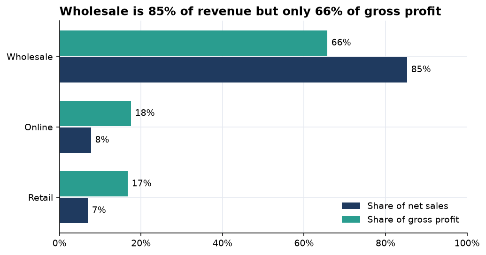
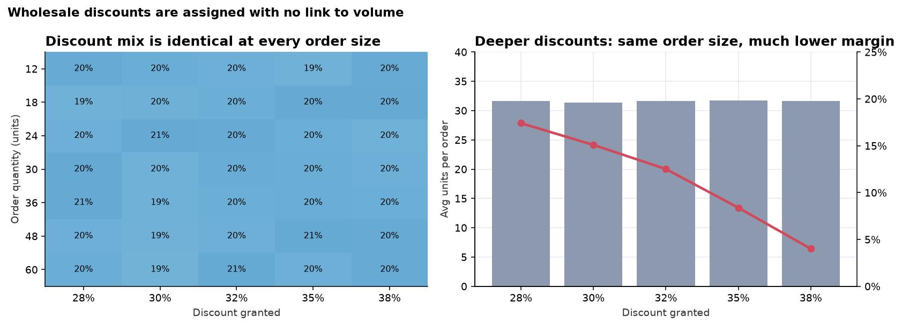
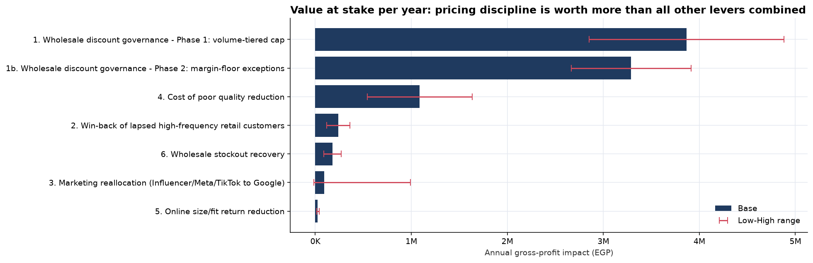

# EL SHARNOUBY GROUP - HVIA Business Discovery & Analytics Report

*Data window: Oct-2023 to Sep-2026 (three fiscal years, Oct-Sep). All figures in EGP. Every number is reproducible with `python run_pipeline.py`.*

## 1. Executive Summary

EL SHARNOUBY GROUP sold **EGP 421.3M** over three years and earned **EGP 64.9M gross profit (15.4%)**. Revenue grew 10.8% in FY25 and only 3.3% in FY26, while gross margin stayed flat at ~15.5%: **growth is not converting into profit.**

The reason is structural. **Wholesale is 85% of sales but earns an 11.9% margin**, against 35-37% in retail and online, even though unit cost is identical across channels. Wholesale discounts average 32.6%, are chosen **with no relationship to order size** (a model with 10 features explains 0.8% of their variance), **buy no extra volume** (p = 0.58), and produce **4,876 invoices sold below cost**.

Beyond what the brief asked, we found and prototyped a fix: a **Wholesale Deal Desk** (volume-tiered discount cap + 15% margin floor + approval routing). Re-pricing three years of real invoices shows **+EGP 2.9-4.9M gross profit per year from Phase 1 alone (+17% of FY26 gross profit)** and +EGP 5.5-8.8M with Phase 2. It remains profitable even if re-priced customers cut volume by 48%.

Other findings: wholesale runs on 11 days of stock cover while retail/online hold ~4 months (EGP 7.5M excess); two suppliers collapsed to ~15% on-time delivery; Sewing/Finishing and LINE-04 drive factory delays; the estimated cost of poor quality is EGP 20.3M (31% of gross profit); marketing attribution over-claims online revenue 5.5x.

## 2. Business Context

A vertically integrated apparel group: **LEO MODA** (kids/family brand; Sidi Bishr store + online), the **Wholesale Desk** (B2B volume), and the **LEO PRODUCTION HUB / LEO PRINT** factory (cutting, sewing, printing, finishing, packing). Demand is seasonal in two opposite waves: summer lines peak Jun-Aug; sweatshirts and autumn pajamas peak Nov-Dec. The connected flow is *suppliers -> materials -> production -> printing -> QC -> inventory -> three channels -> customers -> returns*.

## 3. Data & Methodology

- **18 source tables, 180,000 invoice lines, 25,634 customers, 59 SKUs, 3 locations.** Raw files are untouched; the pipeline validates, cleans, integrates (every join checked for row-count preservation and many-to-one grain) and writes 19 analytical datasets.
- **81 data-quality checks:** structurally clean (no duplicates, orphan keys or broken identities). Ten business flags were kept and analysed, including loss-making invoices and reconciliation gaps: marketing-attributed revenue is 5.5x actual online sales; web orders (47.5K) < online invoices (71.6K); production orders (6.3M units) are 3.8x units sold; QC/print rejects are often unlabeled.
- **Method choices:** rules and statistics first (Pareto, RFM, cohorts, chi-square, OLS with robust/clustered errors, ratio-to-moving-average seasonality); ML only where it adds evidence (a gradient-boosting diagnostic for discount predictability, with a time-based split, baseline and permutation importance). Cross-function links are tested on month-over-month *changes* to avoid spurious trend correlations.

## 4. Key Findings

| Area | Finding | Evidence |
|---|---|---|
| Profitability | Growth slowing; margin flat | Sales FY24/25/26: 129.5M / 143.5M / 148.3M; GM 15.3% / 15.3% / 15.6% |
| Channels | Wholesale volume, retail/online profit | 85% of sales vs 66% of GP; GP per unit EGP 29 vs 126 (retail) / 115 (online) |
| Discounts | Deeper discount buys nothing | Jun-Jul 2026 promo: discount 7.3%->9.7%, volume lift +5.2% (same as no-promo years), GP/day -2.7% |
| Customers | Silent high-value base; weaker new cohorts | 3,745 at-risk frequent buyers = 32% of retail-customer sales (median 229 days silent); next-quarter retention 91% -> ~44% |
| Inventory | Mirror-image imbalance | Wholesale 11 days cover, 36/59 SKUs below reorder point; retail/online ~115 days, 33/59 overstocked; EGP 7.5M excess |
| Marketing | Platform ranking is clear | ROAS: CRM 67x, Google 10x, TikTok 4.9x, Meta 4.4x, Influencer 1.06x; break-even on gross profit = 2.8x |
| Production | Delays are internal | Sewing + Finishing = 68% of delay days; LINE-04 late 20% vs 15% (p=0.008) |
| Quality | Flat, systemic, poorly coded | Top defect only 12% of loss; 12% unclassified; cost of poor quality EGP 20.3M |
| Suppliers | Two suppliers broke in 2025 | SUP04/SUP09 on-time 65% -> ~15%; other ten steady at ~70% |

## 5. Case Brief Results

1. **Executive sales & profitability** - Growth is not healthy: +14.5% sales in two years, margin unchanged. Sweatshirts are the best family (17.9% margin); 33 of 59 products make 80% of profit. *Action:* manage on gross profit by channel; stop untargeted promotions.
2. **Customer 360** - Retail repeat 83.5%, wholesale 96%. Champions 30.7% of sales; at-risk frequent buyers 31.8%. 6,625 customers lapsed >180 days (EGP 22.0M historical sales). *Action:* WhatsApp win-back (CAC EGP 7) + onboarding for new cohorts (EGP 0.12-0.36M GP/yr).
3. **Channels** - Online +60%, wholesale +13%, retail -4.7% in two years. Online return rate is 2x retail (size/fit is 36% of returns everywhere). Alexandria + Cairo = 47% of sales. *Action:* fix size guidance; investigate retail decline.
4. **Inventory & demand** - ABC/XYZ, turns (wholesale 24.6x vs ~2.9x), cover and status computed per SKU x location. **Own forecast:** seasonal-index model by location x season group; three rolling backtests give WAPE 23.3% (vs 28.6% seasonal-naive, 53.6% naive; ~5% at location-month level). Replenishment: wholesale needs EGP 10.1M of orders (24 SKUs urgent); retail/online carry EGP 6.2M surplus; same-SKU transfers cover only EGP 0.87M, so buying must be frozen on overstocked retail/online SKUs.
5. **Marketing** - Cut 50% of Influencer, pause 7 sub-2x campaigns, +30% to Google, run holdout tests on Meta/TikTok. Spend-to-revenue elasticity ~1.0 (no saturation signal). Value is small and uncertain (EGP -0.02M to +1.0M/yr). Conversion falls from 2.9% to 2.0% when pages load slower than 3.5s.
6. **Production** - Plan attainment ~91%, rejects 2.5%, efficiency ~82% on all lines; the differentiator is delay. Orders needing >15h overtime are late 66% of the time (overtime is a symptom). Hub-reported utilisation averages 70%.
7. **Quality & returns** - Pareto is flat across nine defect types; fabric/stitching defects correlate with matching returns (r=0.33, p=0.011), print defects do not. *Priorities:* fix defect coding, systemic process control (curing temperature, calibration, pattern), then the 10 priority products.
8. **Printing** - PR-M03 rejects 3.0% vs 2.6% (p<0.001); PR-M02 loses 591 hours; 80% of downtime is unplanned; more downtime means lower yield (r=-0.21). *Maintenance order:* PR-M03, PR-M02, PR-M01; set-up reduction everywhere.
9. **Supply chain** - SUP04 (contracted) and SUP09 (uncontracted) fail; thread, ink and rib cotton have the highest shortage risk; input prices moved -1% to +8%. *Matrix:* enforce SLA on SUP04, replace/dual-source SUP09, tighten dates for four mid-tier suppliers.
10. **Integrated story + forecast** - FY27 base: 607K units, EGP 153.9M sales, EGP 24.0M GP. Quantified levers below.

## 6. Root Causes

- **Why is profit thin?** Unmanaged wholesale pricing (discount independent of volume, cost, customer or time).
- **Why do stock-outs and excess coexist?** Replenishment is not forecast-driven and differs by channel: wholesale runs lean (11 days), retail/online run heavy (~115 days).
- **Why are factory orders late?** In-factory bottlenecks (Sewing/Finishing, LINE-04). Supplier lateness does **not** statistically explain production delay (r=0.05, p=0.76, no lagged effect) - supplier decay is a separate, concentrated, not-yet-materialised risk.
- **Why do quality losses persist?** Even, systemic variation plus weak defect classification, not one dominant defect.
- **Why is marketing hard to steer?** Platform attribution does not reconcile to sales.

## 7. New Opportunity: Wholesale Discount Governance

**Problem -> Evidence -> Root cause.** Wholesale discount = 80% of pre-discount margin given away. Discounts of 28/30/32/35/38% each appear in ~20% of orders at every order size; the diagnostic model reaches R² = 0.008 on held-out 2026 data; a 1-point deeper discount changes order size by +0.03% (95% CI -0.08% to +0.14%). There is **no policy**, and nothing stops sub-cost quotes.

## 8. Proposed Solution

A **Wholesale Deal Desk**: Phase 1 volume-tiered cap (12-23 units max 28%, 24-47 max 30%, 48+ max 32%); Phase 2 15% margin floor; approval route (auto / manager at margin >= 8% / director / reject below cost); monthly leakage report. Prototype: `modeling.evaluate_quote()` (also an interactive checker in the dashboard); policy saved to `outputs/models/deal_desk_policy.json`.

## 9. Expected Business Impact (gross profit per year)

| Lever | Low | Base | High |
|---|---|---|---|
| 1. Wholesale tiered cap (Phase 1) | 2.85M | **3.87M** | 4.88M |
| 1b. Margin-floor exceptions (Phase 2) | 2.67M | 3.29M | 3.91M |
| 4. Cost of poor quality -10/20/30% | 0.54M | 1.09M | 1.63M |
| 2. Win-back 5/10/15% of at-risk pool | 0.12M | 0.24M | 0.36M |
| 6. Wholesale stockout recovery | 0.09M | 0.18M | 0.27M |
| 3. Marketing reallocation | -0.02M | 0.09M | 0.99M |
| 5. Online size/fit returns | 0.01M | 0.02M | 0.04M |
| **Total** | | **8.8M (+38% of FY26 GP)** | |

Phase 1 break-even: profitable until re-priced customers cut volume by **48%**; the observed response is ~0.

## 10. Recommendations

1. **Now (0-30 days):** block sub-cost wholesale quotes; classify QC/print rejects; enforce SLA on SUP04; stop Influencer spend and the untargeted summer promo.
2. **Next (30-90 days):** pilot the tiered cap with the 25 highest-leakage customers; forecast-driven replenishment for the 36 wholesale SKUs at risk; freeze buying on overstocked retail/online SKUs; WhatsApp win-back for the at-risk segment; fix page speed.
3. **Later (90-180 days):** margin floor and approval workflow; Sewing/Finishing re-balancing and LINE-04 review; PR-M03/PR-M02 maintenance plan; dual-source SUP09; Meta/TikTok incrementality tests; size-guide for online.

## 11. Limitations

- The dataset is officially *modelled* (anchored to public products and prices, per the data dictionary), with unusually uniform quality and discount distributions; real-world effects may differ. COGS is an estimate, not a costed standard.
- The zero price-response is observed inside a 28-38% discount band; behaviour outside it (a much higher price) is extrapolation - hence the volume-loss sensitivity and phased rollout.
- Marketing attribution, production volumes (3.8x sales) and procurement vs BOM quantities do not reconcile; related conclusions rely on rates and rankings, not absolute values.
- Cohort retention decline may partly reflect how the data window was built; treat as a signal to verify with CRM data.
- Forecast uses 36 months of history (three seasonal cycles); no external drivers (price, promotions, holidays).
- Value-at-stake is gross profit before implementation cost.

## 12. Next Steps

1. Validate COGS and the discount-approval history with Finance and the wholesale team.
2. Run a 90-day Phase 1 pilot with a control group; track margin, volume and churn weekly.
3. Reconcile marketing attribution, production volumes and BOM data with source systems.
4. Embed the forecast and replenishment rules into a monthly planning cycle; refresh `run_pipeline.py` on new data.
